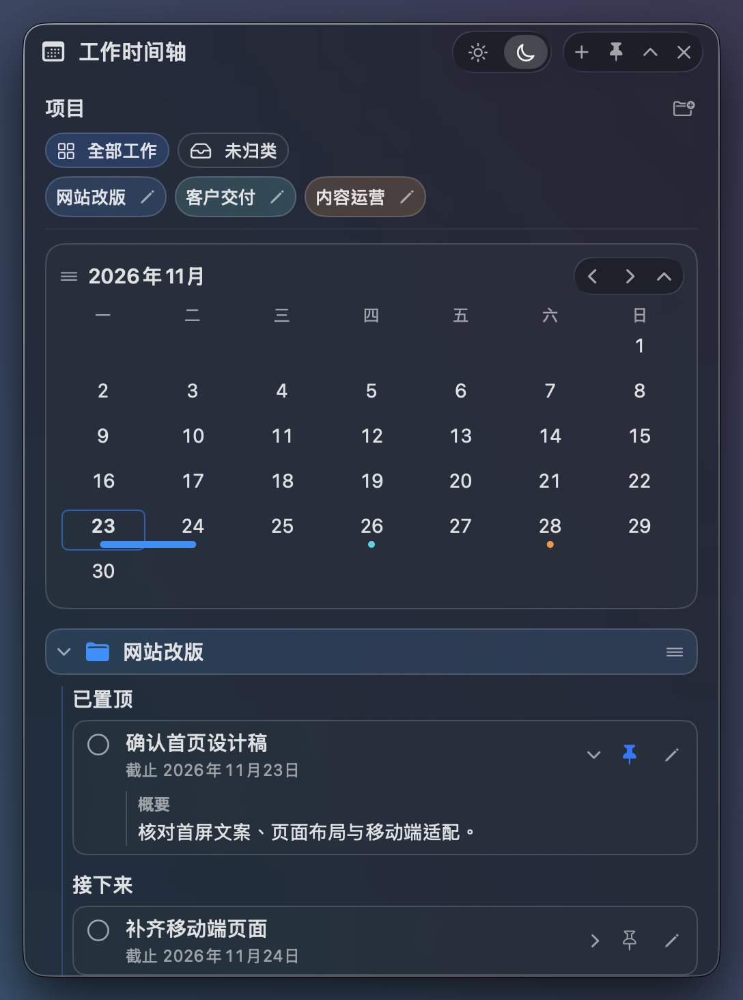
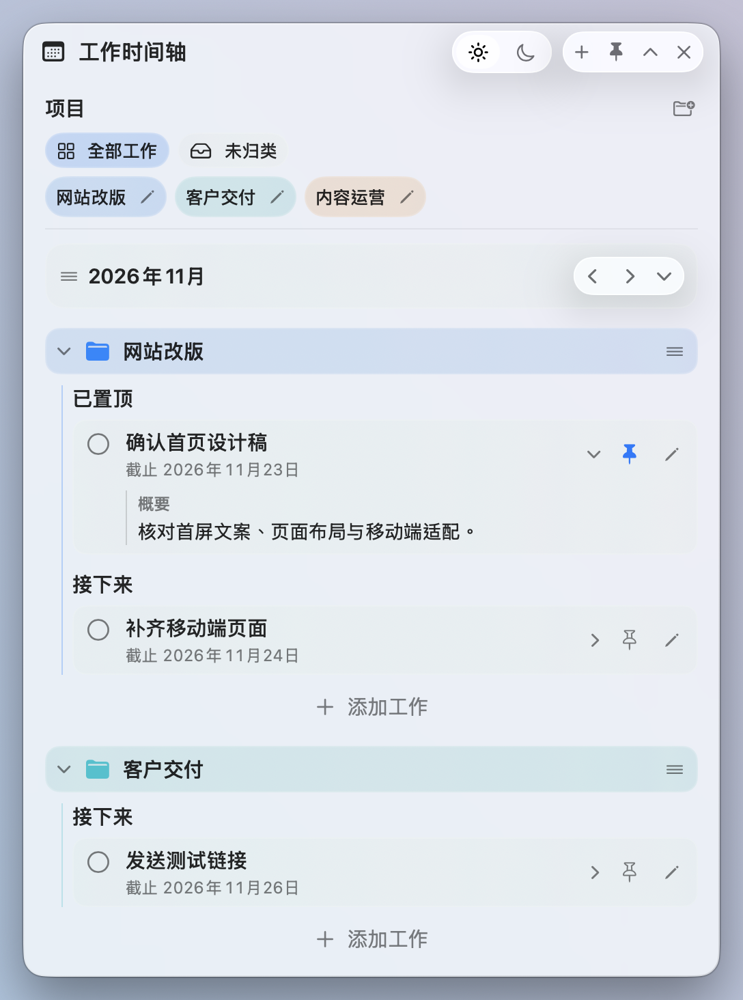
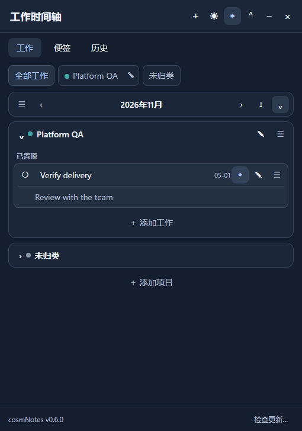

# cosmNotes

[中文](README.md) · **English**

cosmNotes is a floating desktop app for macOS and Windows. Organize projects, tasks, and deadlines in the work timeline, keep sticky notes on your desktop, and add tasks from Codex.

[Download the latest release](https://github.com/Cosmofang/cosmNotes-app/releases/latest)

<p>
  
  
</p>

The macOS work timeline in dark and light mode, shown with demo data.

## Install

| Computer | File on the release page |
| --- | --- |
| Apple Silicon Mac with macOS 14 or later | Universal ZIP ending in `-macOS.zip` |
| Intel Mac with macOS 14 or later | Intel ZIP ending in `-macOS-Intel.zip` or the universal ZIP |
| Windows 10 or 11, 64-bit (x64) | Installer ending in `-Windows-x64-Setup.exe` |

On Mac, unzip the archive and move `cosmNotes.app` into Applications. On Windows, run the installer and launch cosmNotes from the Start menu. The Mac app is ad-hoc signed. The Windows installer is unsigned.

## Work timeline

On Mac, open the cosmNotes menu bar item and choose **工作时间轴** (Work Timeline). On Windows, open the **工作** (Work) tab. You can also bring the timeline back from the system tray.

1. Choose **添加项目** (Add Project), then give the project a name and color. Expand a project in **全部工作** (All Work) to see its tasks.
2. Choose **添加工作** (Add Work) in a project and enter a title and deadline. Select a task title to expand its summary. To add a task without a project, use **未归类** (Unassigned).
3. Check deadlines on the monthly calendar and select a date to filter the list. It uses project colors to mark deadlines and connects consecutive dates for the same project. You can collapse the calendar or move it below the project list.
4. Pin important tasks to move them into **已置顶** (Pinned). Other open tasks are ordered by deadline by default and become overdue after their due date has ended. Drag to reorder projects or tasks in the same group, or drop a task onto another project to move it.

Double-click the title to rename the timeline. Use the title bar buttons to switch themes, pin the window above other apps, or collapse it. Drag the window edges to resize it.

## Desktop notes

Write a Markdown note or keep a checklist, then recover archived notes from history whenever you need them. On Mac, create notes from the menu bar. A collapsed note can snap to a screen edge. On Windows, create a note in the **便签** (Notes) tab, then use the floating-window button to open it separately and pin it if needed.



The Windows work timeline, shown with demo data.

## Add work from Codex

Install Python 3, add the corresponding configuration to `~/.codex/config.toml`, and restart Codex. For example, ask Codex to add “Review homepage design” with Friday as its deadline. The `create_work` tool returns the task and its ID after saving. The macOS edition also exposes tools for managing notes.

**macOS**

```toml
[mcp_servers.cosmnotes]
command = "python3"
args = ["/Applications/cosmNotes.app/Contents/Resources/mcp/cosmnotes_mcp.py"]
```

**Windows**

Replace `YourName` with your Windows username or enter the actual installation path.

```toml
[mcp_servers.cosmnotes]
command = "py"
args = ['-3', 'C:\Users\YourName\AppData\Local\Programs\cosmNotes\resources\mcp\cosmnotes_mcp.py']
```

## Updates and storage

Starting with v0.7.0, cosmNotes checks, prepares, and verifies updates in the background. When the update is ready, choose Restart and Update inside cosmNotes. The Check for Updates command is in the Mac menu bar, the Windows footer, or the Windows tray. Users of v0.6.0 or earlier need to install v0.7.0 or later once to receive in-app updates.

Projects, tasks, and notes are kept on the current device in `~/Library/Application Support/cosmNotes/` on macOS and `%LOCALAPPDATA%\cosmNotes` on Windows.

## Contribute

Create a branch from `main` or fork the repository, then open a pull request. [Report an issue or suggest a feature](https://github.com/Cosmofang/cosmNotes-app/issues)

- **macOS** Install Xcode Command Line Tools and run `./build.sh` in the repository root. The build produces `build/cosmNotes.app`.
- **Windows** Install Node.js 22.12 or later, then run `npm --prefix windows ci` and `npm --prefix windows start` from the repository root. Run `npm --prefix windows run dist` on Windows to build the installer.

For a release, update `Resources/Info.plist`, `windows/package.json`, and the Windows lockfile, then push the matching `vMAJOR.MINOR.PATCH` tag for the merged commit. GitHub Actions tests and publishes the universal Mac ZIP, Intel Mac ZIP, and Windows installer with checksums and signed update feeds.

## Credits and license

cosmNotes builds on StickyNotes v2.2.0 by simony3 and retains the original author attribution and MIT license. [StickyNotes v2.2.0](https://github.com/simony3/StickyNotes/tree/v2.2.0) · [MIT license](LICENSE)
