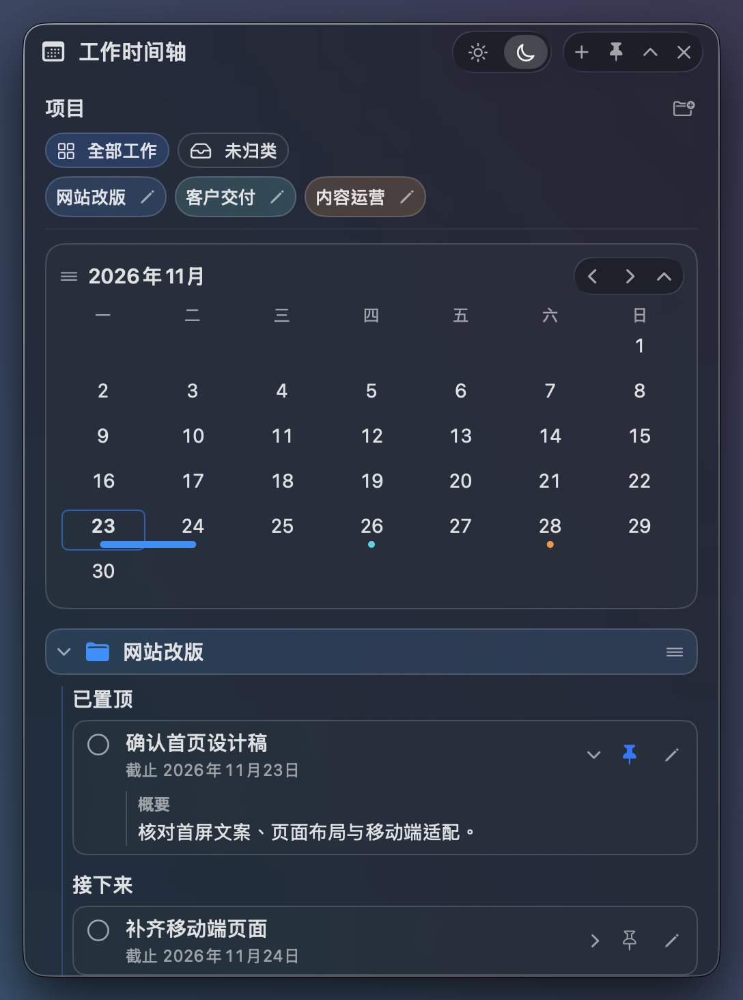
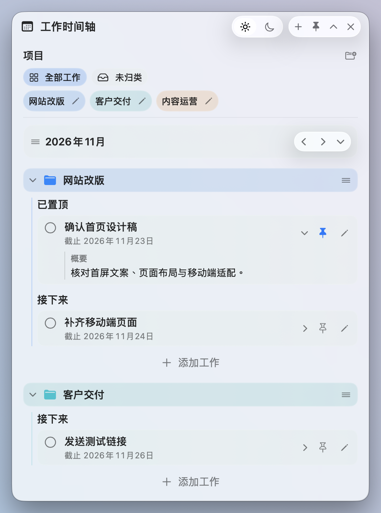

# cosmNotes

**中文** · [English](README.en.md)

cosmNotes 是一款适用于 macOS 和 Windows 的桌面浮窗应用。用工作时间轴管理项目、任务和截止日期，把便签留在桌面上，也可以让 Codex 帮你新增工作。

[下载最新版本](https://github.com/Cosmofang/cosmNotes-app/releases/latest)

<p>
  
  
</p>

macOS 工作时间轴的深色和浅色界面。截图使用演示数据。

## 安装

| 电脑 | 在发行页下载 |
| --- | --- |
| Apple Silicon Mac，macOS 14 或更新版本 | 文件名以 `-macOS.zip` 结尾的通用包 |
| Intel Mac，macOS 14 或更新版本 | 文件名以 `-macOS-Intel.zip` 结尾的独立包，也可用通用包 |
| Windows 10 / 11，64 位（x64） | 文件名以 `-Windows-x64-Setup.exe` 结尾的安装程序 |

Mac 上解压 ZIP，把 `cosmNotes.app` 拖入「应用程序」。Windows 上运行 `.exe`，安装后从开始菜单打开 cosmNotes。Mac 安装包采用临时签名，Windows 安装程序当前为未签名版本。

## 工作时间轴

Mac 用户在菜单栏打开 cosmNotes，然后点「工作时间轴」。Windows 用户打开应用后进入「工作」标签页，也可以从系统托盘打开时间轴。

1. 点「添加项目」创建项目，选择名称和配色。在「全部工作」中展开项目，即可看到项目下的任务。
2. 点项目下方的「添加工作」，填写标题和截止日期。点任务标题展开「概要」，把需要跟进的内容记在这里。也可以在「未归类」中直接新增工作。
3. 用月历查看项目截止日，点日期筛选当天任务。同一项目在单日显示圆点，连续日期用项目色连线。可收拢月历，或把它移到项目列表下方。
4. 给重要任务点置顶按钮，它会进入「已置顶」。其余待办默认按截止日期从近到远排，过了截止当天才算逾期。用拖拽调整项目或同组任务的顺序，也可以把任务拖到另一个项目。

双击顶部标题可改名。用右上角的按钮切换深浅外观、置顶或收拢窗口，也可以拖动边缘调整大小。

## 桌面便签

便签适合记临时想法或列清单。文字便签支持 Markdown 格式，待办便签可逐项勾选。归档的便签可以从历史记录恢复。Mac 上从菜单栏新建文字便签或待办事项，支持便签折叠后吸附到屏幕边缘。Windows 上从「便签」页新建，点便签上的浮窗按钮可单独打开，再按需要置顶。


Windows 工作时间轴，截图使用演示数据。

## 用 Codex 新增工作

安装 Python 3 后，把对应配置加入 `~/.codex/config.toml`，重启 Codex。比如对 Codex 说「用 cosmNotes 新增工作『确认首页设计稿』，截止日期为本周五」。`create_work` 会在写入成功后返回任务和记录 ID。两端都能新增工作，macOS 还提供便签管理工具。

**macOS**

```toml
[mcp_servers.cosmnotes]
command = "python3"
args = ["/Applications/cosmNotes.app/Contents/Resources/mcp/cosmnotes_mcp.py"]
```

**Windows**

把示例中的 `YourName` 换成本机用户名，或填入实际安装路径。

```toml
[mcp_servers.cosmnotes]
command = "py"
args = ['-3', 'C:\Users\YourName\AppData\Local\Programs\cosmNotes\resources\mcp\cosmnotes_mcp.py']
```

## 更新与保存

cosmNotes 在启动时及运行期间每四小时检查一次 GitHub Releases。也可以从 Mac 菜单栏、Windows 窗口底部或系统托盘手动点「检查更新…」。点「下载更新」后，先退出旧版。Mac 解压并替换应用，Windows 运行新版安装程序。

工作、项目和便签保存在当前设备。macOS 的数据目录为 `~/Library/Application Support/cosmNotes/`，Windows 为 `%LOCALAPPDATA%\cosmNotes`。

## 共同开发

从 `main` 创建分支或 Fork 仓库，完成后提交 Pull Request。[提交问题或建议](https://github.com/Cosmofang/cosmNotes-app/issues)

- **macOS** 安装 Xcode Command Line Tools 后，在仓库根目录运行 `./build.sh`。构建产物是 `build/cosmNotes.app`。
- **Windows** 安装 Node.js 22.12 或更新版本，在仓库根目录运行 `npm --prefix windows ci` 和 `npm --prefix windows start`。在 Windows 上运行 `npm --prefix windows run dist` 生成安装程序。

发行时同步更新 `Resources/Info.plist`、`windows/package.json` 和 Windows 锁文件，再为合入的提交推送对应的 `vMAJOR.MINOR.PATCH` 标签。GitHub Actions 会测试并发布 Mac 通用 ZIP、Intel 独立 ZIP、Windows 安装程序及校验文件。

## 致谢与许可

cosmNotes 是「StickyNotes 大神的迭代版」，基于 simony3 开发的 StickyNotes v2.2.0，保留原作者署名和 MIT 许可。[StickyNotes v2.2.0](https://github.com/simony3/StickyNotes/tree/v2.2.0) · [MIT 许可](LICENSE)
